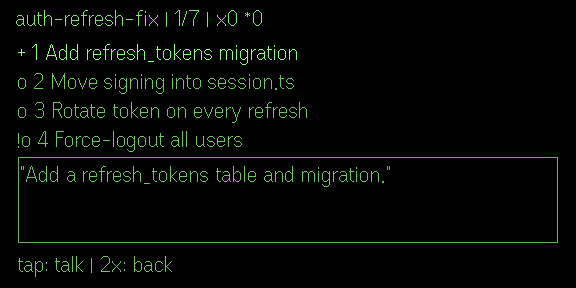

# Pinpoint

**The attention layer for your AI agents, on Even G2 + R1.**

Pinpoint shows only the work that needs you, sorts long output down to the decisions, and lets you point at the exact line with the ring and say the fix. Silence means agree. Your words land where they belong: the agent thread, a Notion comment on the exact block, the Gmail sentence edited in place, a Telegram quote-reply.

[](https://pinpoint.qolso.com/media/pinpoint-demo.mp4)

*Simulator capture, not physical glasses.*

| | |
|---|---|
| **Demo video** | [pinpoint.qolso.com/media/pinpoint-demo.mp4](https://pinpoint.qolso.com/media/pinpoint-demo.mp4) · [GitHub release](RELEASE_URL) <!-- TODO(lead): replace RELEASE_URL with the release asset URL once the video is uploaded --> |
| **Site and simulator** | https://pinpoint.qolso.com |
| **Cloud** | https://pinpoint-api.qolso.com |
| **Tracks** | AI Assistants & Work (main) · Messaging & News (second) · Best Telegram integration |
| **Prior work** | [PRIOR_WORK.md](PRIOR_WORK.md) (disclosed below) |

## Try it now

| You have | Do this |
|---|---|
| **A browser** | Open https://pinpoint.qolso.com and use the simulator on the page: the real glasses app, a virtual R1 ring, real voice. It runs on a sample workspace, so nothing is needed from you. |
| **A real G2** | Scan the QR at https://pinpoint.qolso.com/app/ with the Even app (Even Hub tab → developer section → Scan QR), or sideload the `.ehpk` from the [release](RELEASE_URL). Needs Even app 2.2.10 or newer, signed in at hub.evenrealities.com. The glasses start on a private sample workspace. |
| **Your own agents** | Desk pairing, three steps (details in [docs/desk-pairing.md](docs/desk-pairing.md)): |

1. On your computer: `cd apps/server && npm install && npm run desk`. It prints a one-time pairing code such as `K7Q4-2MXP`.
2. In the Pinpoint phone page (opened from the Even app), choose **Connect your computer**, type the code.
3. The glasses header shows your computer's name instead of "Sample". Your T3 Code threads, Notion pages and Gmail drafts now arrive on the glasses.

## Why

AI agents now do real work all day: coding in several projects, drafting emails, preparing pages. They still need a person to steer them several times a day, and the tools for that are built around text and a yes/no:

- Agent tools are text-heavy. The answer to "what did it do?" is a long transcript.
- Approve or decline is the only control. It says nothing about *which* step is wrong.
- With many projects running, you lose track. You miss the moment an agent needs you, or you approve a plan and miss the one wrong detail inside it.

**Approval is not feedback.** What steers an agent is *which line is wrong and why*. On a laptop that costs a text selection and a typed sentence. On glasses, every app we found (see [docs/landscape.md](docs/landscape.md): 1,148 store apps and 113 hackathon builds read on Nov 27) shows a linear transcript and asks approve/deny, or generates an AI reply for you.

Pinpoint is built around the opposite rule. It never writes anything from nothing. It reviews work that already exists, and it takes fewer gestures than doing the same thing on a phone ([docs/ux-budget.md](docs/ux-budget.md), enforced by tests).

## What it does

| # | Capability | What you see | Gestures |
|---|---|---|---|
| 1 | **Glance status and "Since you looked"** | One line across every agent: `2 need you · 3 working · 4 done today`. A catch-up item lists one line per update since you last looked. | 0 to read; tap a catch-up line to open it |
| 2 | **Sorted to the decisions** | A long plan becomes `7 steps · 1 needs you`. The flagged line says why, grounded in your own text: `Your notes say net-45 (Acme, Nov 12)`. A step that changed since your last review is marked. Opening an item puts the cursor on the first flagged line. | 0 scrolls to reach the flagged line |
| 3 | **Point and say the fix** | Ring swipe to the line, tap, say one sentence, it stops on its own. Silence on every other line means agree. A draft sentence shows the new text in place (`Now: …`). | One flagged mistake: **3 taps + 1 voice** (phone: 10+ taps and typing). Agent question: 2 taps |
| 4 | **Ask** | Hold menu → Ask → say a question. The answer is one short line plus the **exact sentence** from the source that supports it, and jumps to that line. With no good match it says so. | Hold, tap, 1 voice |
| 5 | **Hand off a new task by voice** | "Find a dentist open Saturday…" starts a real agent in an allowed T3 Code project. It appears in your inbox only when it needs you. | Hold, tap, 1 voice <!-- TODO(lead): verify "New task" is in the glasses hold menu and /api/task is on the desk; shared/contract.ts defines TaskResult, but at the time of writing apps/server had no /api/task route --> |

Send is a 5 second **"Sending… tap to undo"** countdown, not a second confirmation screen. After a send, the app returns to the next item that needs you.

Full gesture budgets per flow, with the phone comparison: [docs/ux-budget.md](docs/ux-budget.md).

## Who it is for

**Developers** who run Codex and Claude Code through T3 Code (the open-source agent harness) across several projects.

> The auth plan has 7 steps. Pinpoint says `7 steps · 1 needs you` and opens on step 4, "Force-logout every user by truncating the sessions table". You tap, say "Don't log everyone out. Migrate the existing sessions." and send. The agent gets a review that quotes step 4 and revises.

**Everyday people** who have an assistant doing errands and drafts: a Saturday plan, a reply to the landlord, the school newsletter.

> In the sample workspace (a freelancer's version of the same idea): an assistant drafted a six-sentence reply to Priya about an invoice. One sentence says "net-60", but the freelancer's own notes say net-45 (flagged, with that evidence). You say "net-45, not net-60". The sentence changes in place, shown on the glasses, and the draft sends after the undo countdown. A landlord or school email works the same way; those are intended uses, not sample content yet.

Both audiences use the same screens. The cloud sample can serve a `developer`, `everyday` or `mixed` inbox (`X-Pinpoint-Sample` header in [shared/contract.ts](shared/contract.ts)). <!-- TODO(lead): verify the persona header is implemented in apps/server/src/cloud and that the sample inbox has everyday items (landlord, Saturday plan, school newsletter) before keeping those words -->

## Integrations: what is real, and how it was checked

| Integration | What Pinpoint does | How it was verified |
|---|---|---|
| **T3 Code** (0.1.11) | Reads threads that need you (plan, question, failed run, report). Sends your review as a normal message. Answers agent questions. Never approves shell commands. | Live thread reviewed from the official simulator on Nov 24: open to send **20.4 s**, 2 notes, the agent replied **7.3 s** later ([docs/recording-log.md](docs/recording-log.md), measured on the earlier flow, before the gesture budget). Splitter: 5/5 exact quotes on a real reply, 30/30 across the run ([docs/live-run.md](docs/live-run.md)). |
| **Notion** | Review pages marked `Needs review`. Each note becomes a **comment on the exact block**; the page status moves to `Changes requested` or `Approved`. | Real block-comment round trip on a real workspace, Nov 27 (screenshot: `demo/recordings/notion-launch-comment.png`). Connector unit tests use a mocked `fetch` ([docs/connectors.md](docs/connectors.md)). |
| **Gmail drafts** | Reads a draft that already exists (label `pinpoint`). A spoken fix edits **one sentence in place**; send sends that draft. Scope is `gmail.modify` only. | Real draft edited and sent end to end on Nov 27 (screenshot: `demo/recordings/gmail-sent-net45.png`). Tests mock `fetch`. Google consent screen is in Testing mode, so your own desk needs your own OAuth client. |
| **Telegram** | One topic per task. One notifying card with buttons, the full text collapsed, one **quote-reply per note on the exact sentence**, a receipt with links. Gmail send asks for confirmation on the phone first. | Real bot, private forum group (screenshots: `demo/recordings/telegram-*.png`); `scripts/telegram-verify.mjs` reproduces it. Dry-run mode runs the same code with no bot ([docs/telegram-setup.md](docs/telegram-setup.md)). |
| **DeepSeek API** | The reviewer model on the desk: sorts output into points, flags what needs you, phrases Ask answers, and rewrites one sentence only when the deterministic edit rules cannot. | Every quote and every Ask answer is checked against the source text; a line that cannot be matched is repaired or dropped. The cloud sample uses fixed decks and deterministic retrieval. |
| **Whisper** | Speech to text. Cloud sample: whisper.cpp on the Pinpoint Cloud server. Paired desk: transcribed on your computer. | Used in the simulator and the website; ~1.8 s on the cloud at deploy. |

Pinpoint is not a Notion, Gmail or Telegram client. Each is a place your words are delivered, and a source of work to review.

## Architecture

```
 Even G2 + R1  ◄── display / touch / mic ──►  Even app on the phone
                                                    │  apps/glasses (Even Hub app, WebView)
                                                    │  HTTPS, X-Pinpoint-Device
                                                    ▼
                                         ┌────────────────────────┐
                                         │     Pinpoint Cloud     │  apps/server, PINPOINT_MODE=cloud
                                         │  sample workspace per  │  in-memory only, no keys
                                         │  device + Whisper      │
                                         └───────────┬────────────┘
                                                     │ relay: the desk dials OUT over a WebSocket
                                                     ▼
                                         ┌────────────────────────┐
                                         │  Desk (your computer)  │  apps/server, `npm run desk`
                                         │  decks · review store  │  your tokens stay here
                                         │  DeepSeek reviewer     │
                                         └─┬────────┬───────┬──┬──┘
                                           ▼        ▼       ▼  ▼
                                      T3 Code   Notion   Gmail  Telegram
                                     (threads)  (block   (draft  (topics,
                                                comments) edits)  quote-replies)
```

- The glasses app has no keys. It reaches only `pinpoint-api.qolso.com`.
- Unpaired, the cloud serves a private sample workspace per device. Paired, the cloud only relays opaque bytes to your desk and stores nothing ([docs/desk-pairing.md](docs/desk-pairing.md)).
- The website simulator runs the same glasses state machine and renderer in the browser (`apps/web`).
- Shared types: [shared/contract.ts](shared/contract.ts).

## Privacy and safety

Plain-language version: [docs/privacy.md](docs/privacy.md).

| Topic | What we do |
|---|---|
| **Where data lives** | Cloud: memory only (sample workspaces, hashed pairing secrets). Desk: your computer. Phone: a device id and a pairing token in the Even app's storage. A cloud restart wipes everything and returns devices to the sample. |
| **Voice** | Recorded only while you talk (stops after about 1.2 s of silence, 30 s maximum), transcribed, then discarded. The server deletes its temporary audio file after transcription. |
| **Relay** | Request and response bodies exist only while in flight. Never stored, never logged. Logs hold the route, status, duration and an 8-character device hash. |
| **Tokens** | T3, Notion, Google and Telegram tokens stay on your desk in files that Git ignores (Google token mode 0600). |
| **Sample isolation** | Every device gets its own sample workspace; sample data is fictional. At most 5,000 workspaces, idle ones expire after 7 days. |
| **Rate limits** | Cloud: 300 requests/min per IP, 120/min per device, 20 voice requests/min per device, 5 pairing attempts per 10 min. Bodies capped at 64 KB (JSON), 30 s of audio, 2 MB on the relay. |
| **Scope** | Live mode reads only the T3 projects you list in `T3_PROJECTS`. Gmail scope is `gmail.modify` (no permanent delete). Pinpoint never approves command or permission prompts. |
| **No replies from nothing** | Pinpoint reviews work that exists. Your spoken fix is applied by exact rules first ("net-45, not net-60"); only otherwise is one sentence rewritten, and the server checks that nothing else changed. |
| **Undo** | 5 second undo before any send. Gmail from Telegram asks "Send to Priya as written?" first. A Notion review changes a status and adds comments; it deletes nothing. |
| **What leaves your computer** | The text under review goes to the DeepSeek API for sorting and Ask, and to your own private Telegram group if you enable it. See [docs/privacy.md](docs/privacy.md). |

## Business model

| | |
|---|---|
| **Free** | The sample workspace on the glasses and the website. No account. |
| **Pinpoint Pro, about $4–6 a month** | Desk pairing and the integrations (T3 Code, Notion, Gmail, Telegram) on your own account, with Pinpoint Cloud relaying and sorting. |
| **Teams** | Shared agent inboxes and one billing owner. A plan, not built. |

Why people would pay: the relay and the AI sorting have running costs, and the value is concrete for someone who runs several agents and gets pulled out of other work to steer them. The host Q&A framed the bar as "$3 subscription … 2,000 people" ([docs/host-qa-notes.md](docs/host-qa-notes.md)); comparable glasses apps charge around $10 a month (Chesly, [docs/landscape.md](docs/landscape.md)). **No billing is implemented.** This is the plan, not a shipped product.

## Honest notes

- **Built and tested in Even's official simulator.** No G2 or R1 hardware was available. Legibility, Bluetooth timing, ring-versus-temple input and the system exit dialog are unverified on a real device. [docs/device-readiness.md](docs/device-readiness.md) lists the hardware risks we found by reading Even's docs and templates.
- **Sample versus real.** The website and the glasses default to a *sample* workspace with fictional data and a scripted agent reply after about 5 seconds. Receipts there end in `(sample)`. Real T3 Code, Notion, Gmail and Telegram only run on a paired desk.
- **Live numbers are from Nov 24** and from an earlier version of the flow (before the gesture budget). The gesture budgets are enforced by tests against the current state machine.
- **The relay is not end-to-end encrypted.** The cloud terminates TLS and sees bytes in flight. [docs/desk-pairing.md](docs/desk-pairing.md) states this in its threat notes.
- **Beta dependencies.** Live mode was verified against T3 Code 0.1.11 on one machine.
- **Gmail** uses a Google Cloud project in Testing mode (not verified by Google), so a desk needs its own OAuth client ([docs/connectors.md](docs/connectors.md)).
- The splitter can misread an unusual reply. Quotes are checked against the source, so the failure is a weaker list, not invented text.

## Prior work

The repository starts from three parts of the author's earlier **Agent Relay** project (`github.com/sonozaki7/even-agent-bridge`, MIT, same author, built Nov 6–8, 2026), imported unchanged in the first commit: the Even Hub glasses scaffold, the Remotion film project, and a read-only T3 status bridge kept for reference. Everything else was built during the hackathon, Nov 23–29, 2026. See [PRIOR_WORK.md](PRIOR_WORK.md).

## Repo map

| Path | What it is |
|---|---|
| `apps/glasses/` | The Even Hub app (TypeScript, SDK 0.0.16): screens, state machine, voice. `pinpoint.ehpk` is the package. |
| `apps/server/` | One server, three modes: `demo` (fixtures), `live`/desk (T3, Notion, Gmail, Telegram, reviewer model), `cloud` (sample workspace + relay). |
| `apps/web/` | The website, the try-it simulator and the `/app/` build for the QR code. |
| `apps/site/` | Static site assets (media, `CNAME`). |
| `shared/` | `contract.ts` (types between glasses and server), edit and Ask grammar. |
| `demo/` | Fixtures, sample workspace, simulator recording scripts, the Remotion film. |
| `deploy/` | Pinpoint Cloud deployment ([deploy/README.md](deploy/README.md)). |
| `scripts/` | `demo.sh`, Telegram check, Notion and Google connect, seed data. |
| `docs/` | Design notes and runbooks. Start with [docs/ux-budget.md](docs/ux-budget.md), [docs/connectors.md](docs/connectors.md), [docs/telegram-setup.md](docs/telegram-setup.md), [docs/desk-pairing.md](docs/desk-pairing.md). |

## Run and test

Node.js 22.13 or newer.

```sh
npm run demo                  # demo server (8787) + glasses preview (4173), no keys needed
npm run check                 # server tests, typecheck, glasses tests, build, UI check, fixture checker
npm --prefix apps/web run dev # the website and simulator
cd apps/server && npm run desk  # pair your own computer (live mode needs T3_PROJECTS in .env)
```

Official simulator, second terminal: `npm --prefix apps/glasses run simulator -- http://127.0.0.1:4173`. Live mode, connectors and Telegram setup: [docs/connectors.md](docs/connectors.md), [docs/telegram-setup.md](docs/telegram-setup.md), [docs/t3-api-notes.md](docs/t3-api-notes.md). Glasses app details: [apps/glasses/README.md](apps/glasses/README.md). Cloud server: [apps/server/CLOUD.md](apps/server/CLOUD.md).

## Credits and license

Built by [sonozaki7](https://github.com/sonozaki7) for the Heads Up hackathon (Even Realities × TVM Ventures), November 2026. Independent project, not affiliated with or endorsed by Even Realities, the T3 Code project, Telegram, Notion, Google, DeepSeek or the organizers. Even G2, Even R1 and Even Hub are products of Even Realities.

MIT. See [LICENSE](LICENSE).
